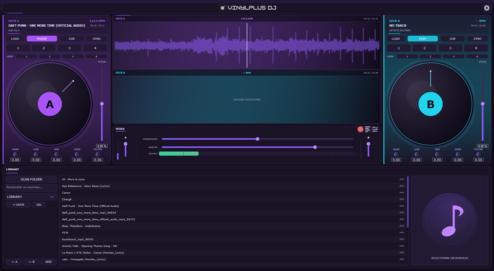
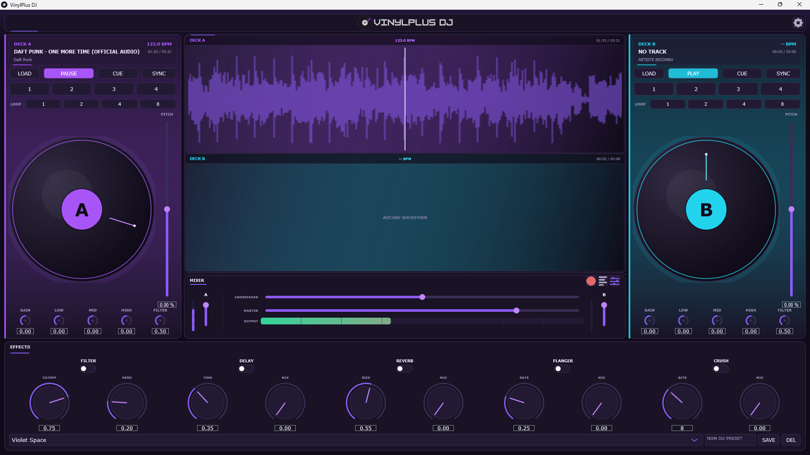
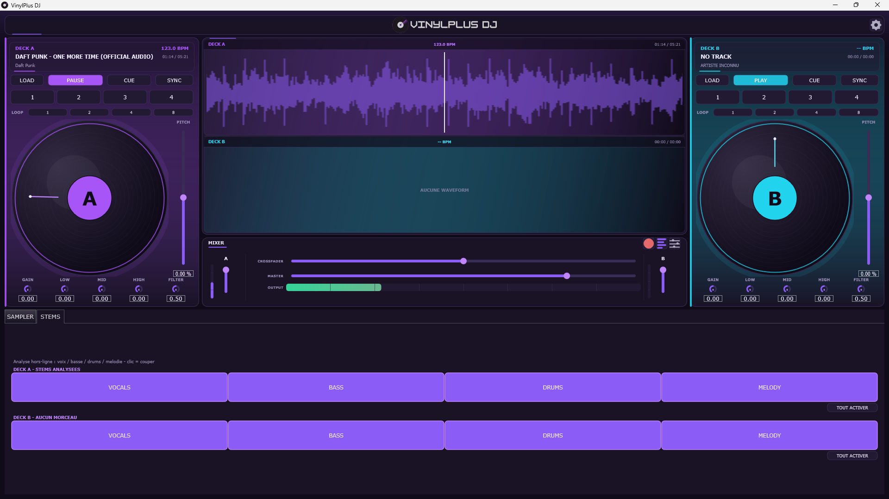
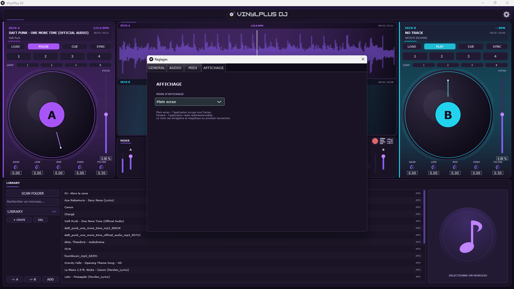

<div align="center">


# VinylPlus DJ

**Application DJ originale pour Windows**, en C++20 / JUCE 8, conçue pour un set en direct avec deux platines, un mixer, une bibliothèque, des effets, un sampler, des stems et le contrôleur **Hercules DJControl Starlight**.

**Aucun compte. Aucune licence. Aucun serveur d'activation.**

</div>

---

## Aperçu



L'interface sombre à accent **violet** reprend une ergonomie de logiciel DJ professionnel : les deux platines encadrent les waveforms centrales, le mixer horizontal se trouve juste en dessous et la bibliothèque occupe le bas de l'écran. La platine A est accentuée en violet, la platine B en cyan.

---

## Fonctionnalités

### Platines

- **2 platines indépendantes** avec chargement **WAV / AIFF / FLAC / OGG / MP3**.
- **Grand jog wheel** par platine : glisser pour scratcher ou se déplacer, rotation synchronisée avec la lecture.
- En-tête de platine : titre, artiste, **BPM détecté localement**, temps écoulé / durée et état des stems.
- **Lecture / pause**, **CUE**, **SYNC** et pitch **±50 %** (comportement vinyle : vitesse et hauteur).
- **EQ 3 bandes** (LOW / MID / HIGH), **gain** et **filtre par platine** :
  - passe-bas à gauche du potentiomètre,
  - passe-haut à droite,
  - position centrale neutre.
- **4 hot cues** par platine :
  - clic sur un pad vide = poser le cue,
  - clic sur un pad actif = y revenir,
  - `Maj + clic` = effacer.
- **Boucles de beat** 1 / 2 / 4 / 8 temps.
- **SYNC tempo** : aligne le BPM de la platine cible sur l'autre platine.
- Chargement par glisser-déposer depuis la bibliothèque ou via le bouton `LOAD`.

### Waveforms centrales

- Deux waveforms empilées : **deck A au-dessus, deck B en dessous**.
- La **waveform défile sous une tête de lecture blanche fixe au centre**.
- Style original : forme d'onde violette, sans bandes de fréquences colorées, ni beatgrid, ni marqueurs de cue superposés.
- Clic sur une waveform pour naviguer dans le morceau.
- En-tête par waveform : deck, BPM et position.
- La zone supérieure est compacte pour laisser un maximum de place à la bibliothèque.

### Mixer

- **Crossfader**, faders de voie verticaux A / B et **VU-mètres par voie**.
- **Master** et grand **VU-mètre master** post-effets / post-limiteur.
- Icônes compactes dans le bandeau mixer :
  - `FX` : afficher / masquer le rack d'effets,
  - `STEMS` : afficher / masquer le panneau Sampler / Stems,
  - `REC` : démarrer / arrêter l'enregistrement.

### Effets



- Rack escamotable, masqué par défaut.
- Effets inclus :
  - filtre résonant,
  - delay,
  - reverb,
  - flanger,
  - bitcrush.
- Presets fournis : *Violet Space*, *Neon Echo*, *Club Filter*, *Lo-Fi Tape*, *Wide Room*.
- Création, sauvegarde et suppression de **presets personnels**.
- Les LEDs FX du Starlight reflètent l'état des effets.

### Stems



- **4 stems par platine** : `VOCALS`, `BASS`, `DRUMS`, `MELODY`.
- Analyse **hors-ligne** lancée automatiquement en arrière-plan au chargement d'un morceau.
- La lecture bascule sur les stems analysées sans interrompre la platine.
- Chaque stem peut être coupée / réactivée, individuellement ou via `TOUT ACTIVER`.
- État affiché au-dessus de chaque platine : `ANALYSE STEMS xx %`, `STEMS ANALYSEES` ou `MODE FREQUENTIEL`.
- Pendant l'analyse, pour les morceaux de plus de 10 minutes ou en cas d'échec, un **repli fréquentiel temps réel** prend le relais.
- L'analyse combine HPSS et extraction du contenu central : il s'agit d'un DSP original, **pas d'un modèle d'IA** type Demucs. La séparation reste approximative.

### Sampler

- **8 slots indépendants** avec pads de déclenchement.
- Clic = jouer / arrêter un sample.
- Clic droit ou bouton `...` = charger un sample audio.
- Menu contextuel `Charger / Effacer`.
- Volume général et bouton `STOP ALL`.
- Les pads du Starlight peuvent contrôler le sampler ou les stems selon le réglage général.

### Hercules DJControl Starlight

Détection automatique du contrôleur et mapping intégré, sans configuration.

| Contrôle | Message MIDI | Action |
|---|---|---|
| Crossfader | CC 0, canal 1 | Crossfader |
| Volume Deck A / B | CC 0, canaux 2 / 3 | Gain |
| Filter Deck A / B | CC 1, canaux 2 / 3 | Filtre de platine |
| Low Deck A / B | CC 2, canaux 2 / 3 | EQ low |
| Pitch Deck A / B | CC 8, canaux 2 / 3 | Pitch |
| Jog Deck A / B | CC 10, canaux 2 / 3 | Déplacement relatif |
| Play / Cue / Sync A | Notes 7 / 6 / 5, canal 2 | Transport A |
| Play / Cue / Sync B | Notes 7 / 6 / 5, canal 3 | Transport B |
| Pads 1-4 A / B | Notes 0-3, canaux 7 / 8 | Hot cues |
| Pads 1-4 + Shift | Notes 8-11, canaux 7 / 8 | Effacer hot cues |
| Pads loops | Notes 16-19, canaux 7 / 8 | Boucles 1 / 2 / 4 / 8 |
| Pads FX | Notes 32-35, canaux 7 / 8 | Filtre / Delay / Reverb / Flanger |
| Pads mode Sampler | Notes 48-51, canaux 7 / 8 | Sampler ou Stems |

- Mode des pads **Sampler / Stems** réglable dans `REGLAGES > GENERAL`.
- LEDs renvoyées au contrôleur : Play, Sync, hot cues, boucles, FX, sampler et stems.
- Suppression d'écho MIDI intégrée pour éviter les doubles déclenchements.

### Réglages

L'icône `REGLAGES` dans l'en-tête ouvre une fenêtre à quatre onglets :

- **GENERAL** : mode des pads Sampler du Starlight (**Sampler** ou **Stems**, Stems par défaut).
- **AUDIO** : périphérique audio, canaux, fréquence d'échantillonnage et taille de buffer (WASAPI / DirectSound via JUCE).
- **MIDI** : périphériques détectés, MIDI learn, mappings appris et bouton `CLEAR`.
- **AFFICHAGE** : choix entre **Plein ecran** et **Fenetre**.



Le mode **Plein ecran est activé par défaut**. Le choix est enregistré dans `settings.json` et réappliqué au prochain lancement. Le changement est effectif immédiatement.

### Bibliothèque

- Grande bibliothèque en bas de l'écran.
- Scan récursif d'un dossier et recherche instantanée.
- **Crates persistantes**.
- Aperçu de la pochette : artwork intégré au fichier audio ou image `cover`, `folder`, `front`, etc. dans le dossier.
- Logo musical stylisé lorsqu'aucune pochette n'est disponible.
- Chargement vers la platine A ou B par double-clic ou boutons `-> A` / `-> B`.

### Enregistrement

- Icône `REC` dans le mixer : enregistre le **mix master** post-effets et post-limiteur.
- Format : **WAV 24 bits**, dans `%USERPROFILE%\Music\VinylPlus Recordings\`.
- L'icône devient un carré `STOP` pendant l'enregistrement.

### Raccourcis clavier

| Touche | Action |
|---|---|
| `Espace` ou `A` | Lecture / pause platine A |
| `B` | Lecture / pause platine B |
| `1` à `4` | Poser / rappeler un hot cue sur la platine A |

### Réactivité pour le direct

L'application a été optimisée pour un usage live :

- **MIDI traité à 120 Hz** : latence d'entrée d'environ **8 ms** au lieu de 33 ms.
- **Thread audio non bloquant** : enregistrement et sampler utilisent des try-locks ; une manipulation UI ne fige pas le mix.
- Les **platines arrêtées** ne consomment plus de DSP audio.
- Le crossover de stems est **ignoré quand les stems sont neutres**.
- Les VU-mètres sont calculés une block audio sur quatre, suffisant pour un affichage à 30 Hz.
- Soft-clip rapide à approximation polynomiale à la place de `tanh` par échantillon.
- Waveforms mises en cache et rafraîchies uniquement quand la position change.

---

## Téléchargement et exécution

L'exécutable Release est fourni à la racine du dépôt :

```
VinylPlus DJ.exe
```

Aucune installation ni activation n'est nécessaire. Sur Windows, il peut être nécessaire d'autoriser le fichier via l'avertissement SmartScreen d'abord.

---

## Compilation

Prérequis : **CMake ≥ 3.22**, **Visual Studio Build Tools / MSVC**, **Ninja**.

Depuis un Developer PowerShell initialisé avec `vcvars64` :

```powershell
cmake -S . -B build -G Ninja -DCMAKE_BUILD_TYPE=Release
cmake --build build --parallel 2
```

L'exécutable est produit dans :

```
build/VinylPlusDJ_artefacts/Release/VinylPlus DJ.exe
```

> Utiliser `--parallel 2` : une parallélisation plus élevée peut provoquer des erreurs MSVC `C1060` sur certaines machines.

---

## Données utilisateur

```
%APPDATA%\VinylPlusDJ\
├── library.json     # dossier scanné, morceaux, crates
├── midi_map.json    # mappings MIDI learn
├── presets.json     # presets d'effets
└── settings.json    # mode pads Starlight et mode d'affichage
```

Enregistrements :

```
%USERPROFILE%\Music\VinylPlus Recordings\
```

---

## Limites connues

- Pas de **keylock / time-stretch** : le pitch modifie vitesse et hauteur comme un vinyle.
- Le **SYNC** aligne le tempo, pas la phase des beats.
- Les boucles sont pilotées par le timer de l'interface, avec une précision d'environ 30 ms.
- Les stems sont approximatives : voix avec instruments centrés, drums avec réverbération, mélodie avec résidus harmoniques.
- L'analyse n'est pas mise en cache sur disque et est refaite après redémarrage.
- Les morceaux de plus de 10 minutes utilisent le repli fréquentiel temps réel.
- Les samples du sampler ne sont pas persistés entre deux lancements.
- Pas encore de 4 platines, DVS, beat jump, slicer, vidéo ou streaming.

---

## Indépendance et licence

VinylPlus DJ est une création **originale**. L'interface s'inspire de l'ergonomie des logiciels DJ professionnels, mais ne copie ni l'habillage, ni les assets, ni le code de ces logiciels.

Le projet n'utilise aucun mécanisme de licence, de compte utilisateur ou de serveur d'activation.

JUCE est utilisé sous **GPLv3** : toute distribution du binaire doit respecter les termes de la GPLv3 (code source disponible) ou être couverte par une licence commerciale JUCE.

Formats audio pris en charge par JUCE : WAV, AIFF, FLAC, OGG et MP3.
